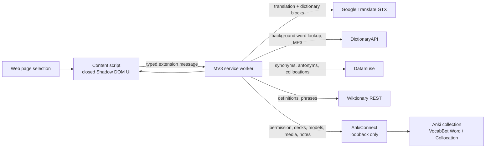
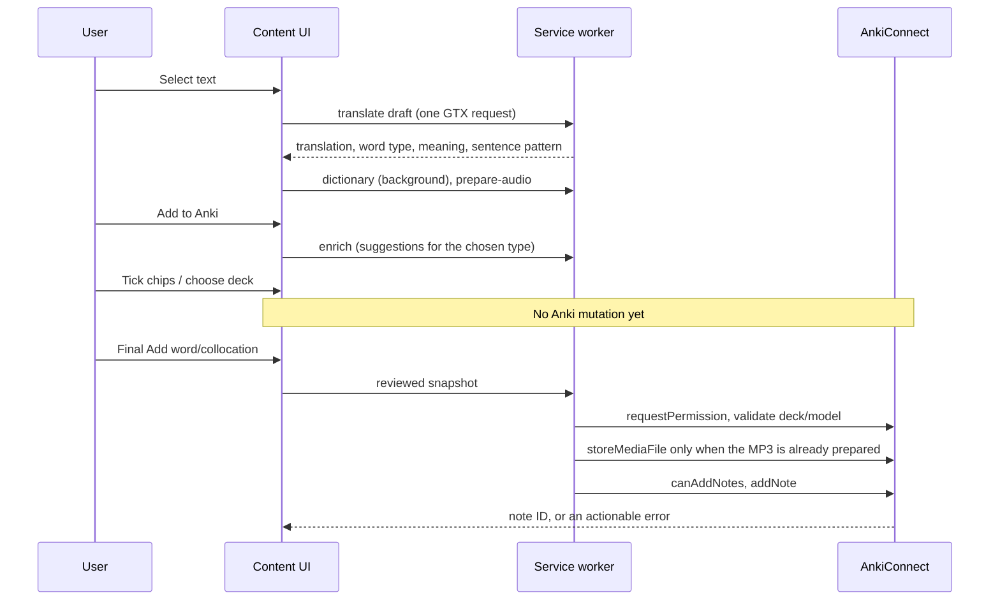
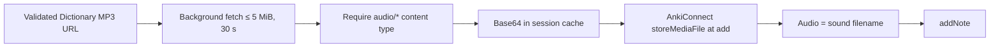

# Anki Add Vocabulary Architecture

## System overview



The extension has no dependency on `vocab_bot`, no Python backend, no local database, and no cloud account.

## Components

### Content script — `content.js`

Runs on normal `http` and `https` pages.

Responsibilities:

- validate selected text;
- extract the source sentence, page title, and URL;
- render a closed Shadow DOM overlay that page CSS cannot alter;
- own the three user-facing stages: translate, edit (with tickable suggestion chips), choose deck/final add;
- render untrusted strings through DOM text/value properties;
- never access AnkiConnect credentials or arbitrary network endpoints.

The content script sends only enumerated messages to the service worker. It cannot choose an Anki action, deck/model mapping, request header, or remote endpoint.

Loaded before it: `term-kind.js` (kind/type lists, term normalisation), `suggestions.js` (chip groups), `page-context.js` (sentence and IPA from the page).

### MV3 service worker — `background.js`

The trusted orchestration boundary.

Responsibilities:

- call the fixed translation, DictionaryAPI, Datamuse, and Wiktionary endpoints;
- validate translation, draft, deck, and Anki URL data;
- request AnkiConnect permission;
- list/create decks;
- create validated VocabBot models only when absent;
- detect word type and collocation type (`word-type.js`, `collocation-type.js`, vendored compromise tagger);
- merge suggestions within a 2.5 s budget and cache them (`enrich.js`, `sources.js`);
- download and validate word MP3 files ahead of the add;
- upload media with `storeMediaFile`;
- construct a fixed `addNote` request only after final user confirmation.

Allowed message types:

```text
translate            dictionary          prepare-audio
enrich               list-decks          create-deck
add-note             status              get-ui-settings
block-site           save-settings       open-options
model-status *       upgrade-models *
```

`*` only from the Options page (`chrome-extension://<id>/options.html`, no tab); content scripts are rejected.

Unknown messages fail closed.

### AnkiConnect

Only loopback URLs are allowed:

```text
http://127.0.0.1:<port>
http://localhost:<port>
```

The worker calls `requestPermission` before Anki operations and includes the AnkiConnect API key only when AnkiConnect reports that it requires one.

## User flow and mutation boundary



The final add action is the only note-creation boundary. Closing the overlay, changing target language, previewing audio, editing fields, loading suggestions, searching decks, and creating a deck do not add a note. After the add, a short confirmation closes itself; it stays only when the MP3 was not ready or the note type is not the current design.

## Translation and dictionary data

### Translation

The service worker calls Google Translate with automatic source detection:

```text
https://translate.googleapis.com/translate_a/single
?client=gtx
&sl=auto
&tl=<selected-target-language>
&dt=t&dt=bd&dt=ss&dt=md&dt=ex
&q=<selected-text>
```

`bd`, `ss`, `md`, and `ex` supply word types, synonyms, definitions, and examples in the same request, so Step 1 needs no dictionary call. The final add uses one more `dt=t` request to append target-language glosses to the reviewed lists.

The worker tries the supported Google hosts in order and reports a user-safe error when all fail.

### Dictionary enrichment

For a single English word only:

```text
https://api.dictionaryapi.dev/api/v2/entries/en/<word>
```

Requested **after** Step 1 renders, because uncached lookups take about 20 s. It supplies US pronunciation, extra word types, antonyms, and the MP3 URL, which then downloads in the background. Failures are cached so the same word is not retried on every selection. Dictionary enrichment is non-fatal.

### Suggestions (`enrich`)

Datamuse (`rel_syn`, `rel_ant`, `rel_bga`, `rel_jja`/`rel_jjb`, `ml`) and Wiktionary definitions, merged per word type with a 2.5 s budget and cached for 30 minutes in `chrome.storage.session`. Only the term is sent; never the page sentence or URL.

## VocabBot model mapping

### Word

| Draft value | Anki field |
|---|---|
| Term | `Word` |
| Pronunciation | `Pronunciation` |
| Type | `Category` |
| Translation | `MeaningVN` |
| Example | `Example` |
| Ticked patterns | `Patterns` |
| Ticked collocations | `Collocation` |
| Ticked synonyms | `Synonyms` |
| Ticked antonyms | `Antonyms` |
| Source sentence (only when it differs from Example) | `Context` |
| Source link | `Source` |
| Stored MP3 | `Audio` |

### Collocation

| Draft value | Anki field |
|---|---|
| Term | `Collocation` |
| Pattern template | `Pattern` |
| Translation | `Meaning` |
| Example | `Example` |
| Ticked similar expressions | `Synonyms` |
| Source sentence | `Context` |
| Source link | `Source` |
| Stored MP3 | `Audio` |

All plain text is HTML-escaped before it reaches an Anki HTML field. Newlines are converted to `<br>` only after escaping.

## Model installation

`models.js` contains the VocabBot-compatible model definition, templates, and styling.

On a final add, the worker:

1. reads `modelNames`;
2. calls `createModel` only when the required model is absent;
3. calls `modelFieldNames`;
4. rejects the add if any required field is missing;
5. never overwrites an existing model template or CSS.

Settings → Note types reports each model as current, older, customized, unsupported, or missing fields, and **Upgrade card templates** is the only action that replaces a template and its styling (a customized one only after confirmation). This protects user-customized VocabBot models while still allowing a clean collection to start using the extension.

## Audio media pipeline



Only `https://api.dictionaryapi.dev/...` audio URLs are accepted. The download starts as soon as the URL is known and its state is visible on the edit screen. **Add never waits for it:** without a prepared MP3 the note is added with an empty `Audio` field (the template falls back to Anki TTS) and the confirmation says so. The extension never puts a remote media link in an Anki field.

## Security and privacy

- `chrome.storage.local` is restricted to trusted extension contexts.
- Content scripts do not receive AnkiConnect API keys.
- Translation target codes are allowlisted.
- AnkiConnect URLs must be loopback HTTP URLs with an explicit port.
- Selected text, translation output, dictionary data, deck names, and Anki errors are untrusted data.
- The extension does not fetch the selected page URL, transmit page HTML, retain a translation history, or use a generic Anki invocation bridge.
- Password fields, content-editable inputs, empty selections, oversized selections, and blocked sites do not start translation.

## Failure behavior

| Failure | Behavior |
|---|---|
| Translation unavailable | Keep the page unchanged and show a retryable translation error. |
| Dictionary unavailable | Continue with translation; no audio card. |
| Anki unavailable | Keep the reviewed draft visible and show connection guidance. |
| Anki permission/API key failure | Do not attempt media or note creation. |
| Deck/model missing | Do not fall back to `Default`; explain the configuration issue. |
| Duplicate note | Do not overwrite or duplicate. |
| MP3 failure | Add the note without audio (Anki TTS) and report it; the failure is cached. |
| Suggestion source down | Return the other sources; the edit screen lists what was unavailable. |
| Unknown add result | Do not retry blindly, preventing an accidental duplicate note. |
